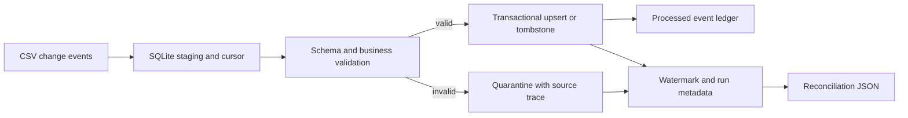

# Incremental Data Ingestion 
A local Python 3.11 data engineering project that incrementally applies customer and order change events from CSV to SQLite. It demonstrates durable watermarks, safe reruns, late arrivals, tombstones, validation, quarantine, batch recovery, run metrics, reconciliation, and reproducible performance measurement.

## What It Does

- Reads CSV change events and orders them by normalized arrival timestamp with deterministic tie-breakers.
- Uses `(arrived_at, source_row_number, event_id)` as a durable per-source watermark. Source change time is tracked separately to prevent stale updates.
- Applies each batch and its checkpoint in one SQLite transaction.
- Uses stable event IDs and a processed-event ledger for idempotent retries.
- Preserves deletes as tombstones and keeps customer/order foreign keys enabled.
- Validates schema, timestamps, entity rules, uniqueness, and order references. Invalid rows are retained with their source row and rejection reason.
- Records run status, row counts, batch count, and failure information, then writes a reconciliation report.
- Replays the complete CSV into a temporary reference database and compares customer/order state, active/deleted counts, and active order totals with the target.
- Generates deterministic synthetic feeds with a fixed seed and built-in edge cases.

See [docs/architecture.md](docs/architecture.md) for design and limitations, and [docs/data_dictionary.md](docs/data_dictionary.md) for source and target fields.

## Architecture



## Quick Start on Windows

Open PowerShell in the project directory. Python 3.11 is required.

```powershell
py -3.11 -m venv .venv
.\.venv\Scripts\Activate.ps1
python -m pip install --upgrade pip
python -m pip install -e ".[dev]"

python -m yottaflex_ingestion generate --output data/source/sample.csv --records 100 --seed 42

python -m yottaflex_ingestion run --input data/source/sample.csv --database database/ingestion.db --report evidence/sample_first_run.json
```

The run prints metrics and writes a JSON reconciliation report. It also replays the complete CSV into a temporary reference database to compare expected source state with the target.

This assumes the CSV is the full appendable history for the source and one source feed owns the target tables; it adds a second processing pass.

The sample generator produces 106 rows from 100 requested baseline records because it adds six labeled edge-case events. The generated source CSV and local SQLite databases are ignored by Git; the curated synthetic sample and verification outputs under `evidence/` are intended to be shareable.

## Run the Sample Twice

Run the same input again against the same database:

```powershell
python -m yottaflex_ingestion run --input data/source/sample.csv --database database/ingestion.db --report evidence/sample_rerun.json
```

On the recorded sample run, the first pass processed 106 rows: 102 applied, 1 duplicate, and 3 rejected; reconciliation passed.

The rerun applied 0 rows, skipped all 106, and reconciliation passed.

## Demonstrate Recovery After a Partial Failure

Use a larger feed so the deliberate failure occurs before the whole input is processed:

```powershell
python -m yottaflex_ingestion generate --output data/source/recovery.csv --records 2500 --seed 42

python -m yottaflex_ingestion run --input data/source/recovery.csv --database database/recovery_evidence.db --batch-size 500 --fail-after-batches 1 --report evidence/recovery_first_failure.json
```

The first run is expected to report status `failed` and return a non-zero exit code: this option deliberately stops after the first committed batch.

Its reconciliation report is also expected to fail because the target has only 500 of the 2,506 input rows; it shows the difference from a full source replay.

Continue by rerunning without the failure option:

```powershell
python -m yottaflex_ingestion run --input data/source/recovery.csv --database database/recovery_evidence.db --batch-size 500 --report evidence/recovery_after_retry.json
```

The recorded retry completed successfully: it skipped the 500 already processed rows, extracted the remaining 2,006 rows, and reconciliation passed.

The report includes expected-from-source and actual-target counts/totals plus current-state fingerprints. The failed attempt's reconciliation is expected not to pass because the full feed had not yet been processed.

To generate only valid baseline records, add `--without-edge-cases`. The default generator includes late, duplicate, missing-field, invalid-reference, and invalid-amount examples. Expected outcomes are not embedded as labels in the input data.

## Source-to-Target Comparison

The run command passes its input feed to the reconciliation report automatically.

The report replays the full CSV into a temporary SQLite database, then compares expected and actual customer/order state, active and deleted counts, active order totals by currency, and SHA-256 fingerprints of current row contents and source versions.

This assumes the CSV is the complete appendable history and the database belongs to one source feed. It adds a second ingestion pass.

Because the reference uses the same pipeline implementation, this is a deterministic replay check, not an independent oracle for transformation logic.

To request the comparison later for an existing run, provide the full feed:

```powershell
python -m yottaflex_ingestion report --database database/ingestion.db --run-id RUN_ID --input data/source/sample.csv --output evidence/reconciliation.json
```

## Automated Tests

Run the test suite with:

```powershell
python -m pytest
```

The recorded local run on Windows with Python 3.11.9 passed all 12 tests in 0.74 seconds.

The tests cover reproducible generation, reruns, duplicates, validation and quarantine, late/stale events, tombstones, schema changes, empty input, out-of-order rows, and partial-failure recovery.

## Performance

Run the benchmark with:

```powershell
python -m yottaflex_ingestion benchmark --records 100000 --seed 42 --batch-size 1000
```

### Recorded Local Result

| Measure | Result |
|---|---:|
| Baseline rows requested | 100,000 |
| CSV rows including edge cases | 100,006 |
| Applied events | 100,002 |
| Stale events | 0 |
| Duplicate events | 1 |
| Rejected events | 3 |
| Batch size / seed | 1,000 / 42 |
| Elapsed ingestion time | 9.04 seconds |
| Throughput | 11,062.6 rows/second |
| Environment | Windows 11, Python 3.11.9 |

The benchmark timer covers ingestion, including staging, validation, SQLite writes, and run metrics; it excludes synthetic data generation.

Hardware details were not recorded, so this is a result from one local run, not a performance guarantee.

See [docs/performance.md](docs/performance.md) for the measurement and optimization notes.

## Verification Evidence

The repository includes these synthetic artifacts:

- [evidence/sample.csv](evidence/sample.csv) — small reproducible input.
- [evidence/sample_first_run.json](evidence/sample_first_run.json) — first sample run and reconciliation.
- [evidence/sample_rerun.json](evidence/sample_rerun.json) — idempotent rerun and reconciliation.
- [evidence/recovery_first_failure.json](evidence/recovery_first_failure.json) — intentional partial failure, with source-versus-target differences shown.
- [evidence/recovery_after_retry.json](evidence/recovery_after_retry.json) — successful recovery run and reconciliation.
- [evidence/benchmark_100k.txt](evidence/benchmark_100k.txt) — recorded 100,000-row benchmark output.

The local SQLite databases are not required; run commands create them when needed.

## Useful SQLite Checks

```sql
SELECT status, input_rows, extracted_count, applied_count, stale_count,
       duplicate_count, rejected_count, batch_count, error_message
FROM ingestion_runs
ORDER BY started_at DESC;

SELECT customer_id, name, email, is_deleted
FROM customers
ORDER BY customer_id;

SELECT event_id, source_file, source_row_number, reason
FROM rejected_records
ORDER BY reject_id;

PRAGMA foreign_key_check;
```

## Design Assumptions and Limitations

- `arrived_at` is a trustworthy source availability time. This lets the pipeline discover an event whose `source_updated_at` is older than the current watermark.
- Source events are immutable by `event_id`. Reusing an ID with different content is quarantined.
- The watermark is maintained per `source_name`, while event IDs and entity keys are database-wide. Use one database per independent domain unless its keys are globally unique.
- Every batch is atomic. Committed batches survive a later failure; their event ledger and watermark commit together.
- Timestamped invalid events are quarantined and checkpointed. Rows without a usable `arrived_at` are quarantined but cannot move the watermark and will be encountered on subsequent scans.
- A customer or order delete is a tombstone. The demo retains history rather than hard-deleting rows.
- The source is an appendable CSV file, not a live API or CDC connector. A production connector can replace this boundary while retaining event validation and target logic.
- SQLite is intended here as a single-machine demonstration target. Multi-writer or high-concurrency deployments should use a server database and a source-native offset.

## Repository Layout

```text
src/yottaflex_ingestion/   Python package and CLI
tests/                     pytest coverage
docs/                      Architecture, data dictionary, and performance notes
data/source/               Generated CSV input (ignored by Git)
database/                  Local SQLite database (ignored by Git)
reports/                   Default reconciliation output (ignored by Git)
evidence/                  Curated synthetic input and verification outputs
```

---

**Author:** Veeresh Basetti

**GitHub:** [veeresh442](https://github.com/veeresh442)

**Repository:** [Incremental Data Ingestion](https://github.com/veeresh442/yottaflex-incremental-ingestion)
